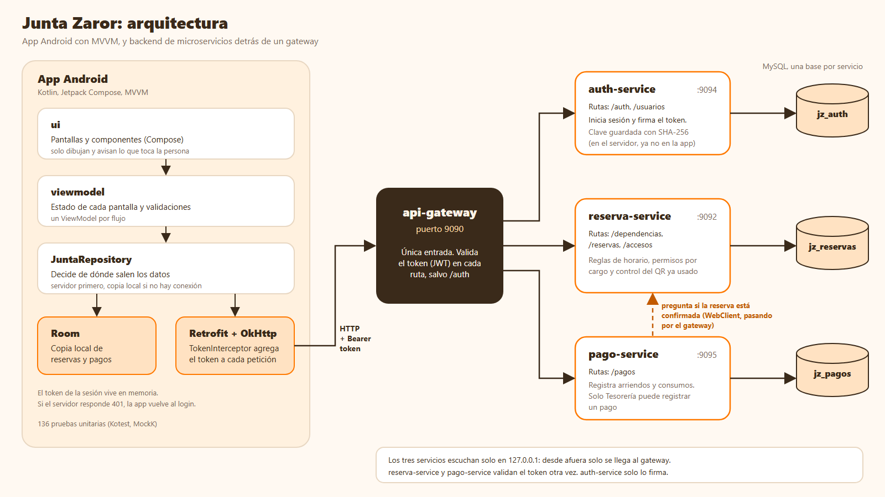

# AppJuntaVecinos

Aplicación Android para administrar los arriendos de las salas de una junta de vecinos y registrar sus pagos. Se conecta a un backend de microservicios ([junta-zaror-backend](https://github.com/PabloRico25/junta-zaror-backend)). El caso es ficticio: Junta de Vecinos Población Zaror, Los Jazmines 425, Cerrillos.

| | |
|---|---|
| Asignatura | DSY1105 Desarrollo de Aplicaciones Móviles, Duoc UC |
| Evaluación | Parcial 4 (continúa el trabajo del Parcial 2) |
| Integrantes | Pablo Alexander Rico Rodríguez, William Martín Rodríguez Troncoso |
| Planificación | [Tablero de Trello](https://trello.com/b/Cb8xIwiv/appjuntavecinos-parcial-2) |
| Otros documentos | [DECISIONES.md](DECISIONES.md): por qué está hecho así. [README del backend](https://github.com/PabloRico25/junta-zaror-backend): endpoints y cómo encenderlo |

## Qué hace

Los vecinos piden reservas del Salón Principal o de la Sala Multiuso. Cuando la reserva está confirmada y pagada, reciben un ticket con código QR. La directiva confirma o rechaza reservas, registra pagos, revisa las finanzas y valida los QR en la entrada. Una tablet fija en una sala puede validar los QR por sí sola (modo puerta).

| Usuario | Puede |
|---|---|
| Vecino/a | Pedir reservas, ver su estado, cancelar las pendientes, ver la disponibilidad y las finanzas de la junta, y mostrar su ticket QR |
| Secretaría | Confirmar o rechazar las reservas pendientes |
| Tesorería | Registrar pagos, con comprobante de cámara o galería |
| Presidencia | Solo mirar |

Los tres cargos de la directiva ven reservas, pagos y resumen financiero, y pueden escanear QR.

## Arquitectura



- **Pantallas** (`ui/screens`) solo dibujan y avisan lo que toca el usuario. **ViewModel** guarda el estado de cada pantalla y valida los formularios. **JuntaRepository** decide de dónde salen los datos.
- La app pide los datos al servidor y los guarda en **Room**. Si el servidor no responde, muestra lo último guardado y avisa. El servidor es quien manda: la app no inventa datos.
- El **token** de la sesión se guarda en memoria. `TokenInterceptor` lo agrega a cada petición y, si el servidor responde 401 con una sesión abierta, avisa para volver al login.
- El detalle de las decisiones está en [DECISIONES.md](DECISIONES.md).

## Funcionalidades implementadas

| Pantalla | La usa | Qué hace |
|---|---|---|
| Login | Todos | Entra con correo y clave contra el servidor. Se cierra sesión desde el menú de la cuenta |
| Mis reservas | Vecino | Lista de reservas con su estado, con ícono y color. Al tocar una se abre su detalle |
| Detalle de reserva | Vecino | Cancela si está pendiente. Abre el ticket si está confirmada y pagada |
| Nueva reserva | Vecino | Formulario con validación de fecha, horas, horario de la sede y horario ocupado. Al enviarla muestra "Solicitud enviada" |
| Ticket QR | Vecino | Muestra el QR, la ventana de ingreso y un código corto |
| Disponibilidad | Vecino y directiva | Bloques horarios libres, confirmados y solicitados por sala y fecha. La directiva ve quién pidió cada uno |
| Finanzas | Vecino | Ingresos, gastos, saldo y gastos por categoría del mes elegido, solo lectura |
| Reservas | Directiva | La Secretaría confirma o rechaza. Al confirmar el servidor revisa de nuevo el choque de horario |
| Pagos | Directiva | Lista de ingresos y gastos, y aviso de las reservas confirmadas que faltan por pagar |
| Registrar pago | Tesorería | Formulario para un pago de arriendo o de un consumo básico, con comprobante opcional |
| Resumen | Directiva | Lo mismo que Finanzas |
| Escanear | Directiva | Valida un QR con la cámara o un código corto escrito a mano |
| Modo puerta | Aparato fijo | Valida QR con la cámara frontal, sin que nadie de la directiva esté presente |
| Sesión vencida | Todos | Avisa cuando el servidor rechaza el token y lleva al login |

**Estados de la conexión.** Las pantallas de listas y detalle muestran tres cosas distintas: un esqueleto mientras carga, una franja con "se muestran los datos guardados" si falla la actualización, y una pantalla con botón Reintentar si no hay nada guardado. Los errores de un formulario se muestran en el campo y los del servidor en un aviso con su mensaje.

**Diseño.** La interfaz sigue el kit de diseño entregado: paleta naranja y crema, tarjetas de reserva con la foto de la sala de fondo, etiquetas de estado con ícono, una cabecera con el nombre, el cargo y el avatar (que abre el menú de la cuenta) y una barra de navegación con íconos propios. Tiene modo claro y oscuro según el teléfono. En pantallas anchas la barra pasa a un panel lateral y el contenido se centra con un máximo de 640 dp. Hay transiciones entre pantallas, listas que aparecen escalonadas y animaciones en los estados de sin conexión, solicitud enviada y puerta. Todas se saltan si el teléfono tiene activado "Reducir animaciones".

## Reglas de negocio

El servidor las aplica y la app las repite para avisar antes de enviar.

- La fecha de una reserva no puede ser pasada. Las horas van de 09:00 a 22:00 y la de fin es posterior a la de inicio.
- No se puede reservar un horario ocupado por una reserva confirmada de la misma sala. Se revisa al pedirla y otra vez al confirmarla.
- Solo se cancela una reserva pendiente. Solo la Secretaría confirma o rechaza, y solo las pendientes.
- Solo la Tesorería registra pagos. Un pago de arriendo exige una reserva confirmada y cada reserva tiene como máximo uno.
- El monto es mayor que 0 y tiene hasta 9 dígitos. La fecha del pago no puede ser futura. Un pago es informativo: no procesa transacciones reales.
- El QR solo existe si la reserva está confirmada y pagada.
- Las fechas se muestran como día-mes-año, por ejemplo 21-10-2026, y viajan y se guardan como año-mes-día para poder ordenarlas y compararlas.

## QR y modo puerta

**Ticket.** El QR lleva la reserva, la sala, la fecha, las horas, el nombre del vecino y una firma (un hash de esos datos más una clave de la app). La pantalla muestra además la ventana de ingreso, por ejemplo "de 17:50 a 18:15", y un código corto como `1-5267E2`.

**Escanear.** La directiva lee el QR con la cámara o escribe el código corto. La app responde:

| Respuesta | Cuándo |
|---|---|
| Acceso permitido | La firma es válida y es el día de la reserva, entre 10 minutos antes y 15 después de la hora de inicio |
| Fuera de horario | La firma es válida, pero es otro día u otra hora |
| Código no válido | No es un QR de la junta, o alguien cambió un dato |

**Modo puerta.** Un aparato, por ejemplo una tablet fija en una sala, valida los QR sin supervisión.

- Para activarlo, en el Login se toca 7 veces seguidas el título "Inicia sesión", con menos de 2 segundos entre toques. Se elige la sala y se inicia sesión con una cuenta de la directiva: el servidor entrega un token de 7 días que solo sirve para registrar ingresos. También se elige una clave para salir, que se guarda como hash. Desde entonces el aparato arranca siempre en "Acerque su QR" y usa la cámara frontal.
- El QR pasa 4 revisiones: firma válida, sala de esa puerta, ventana de ingreso y que no se haya usado antes. Esa última la responde el servidor, así que vale entre todos los aparatos. Si pasa, la pantalla se pone verde con "Puerta abierta". Si no, se pone roja con el motivo, que distingue un QR inválido, un problema de conexión y un error del servidor. El aviso se quita solo a los 4 segundos. La puerta es simulada.
- Para salir se repite el gesto de 7 toques sobre "Acerque su QR" y se escribe la clave elegida.

## Recursos nativos

| Recurso | Para qué | Detalle |
|---|---|---|
| Cámara | Foto del comprobante de un pago | Pide el permiso `CAMERA`. Si se niega, la app avisa y deja usar la galería |
| Galería | Elegir un comprobante ya guardado | No pide permiso. El archivo se copia a la carpeta privada de la app |
| Lector de códigos de Google | Escanear el QR en la pestaña Escanear | Usa la pantalla de lectura de Google Play Services |
| Cámara frontal (CameraX y ML Kit) | Leer el QR en el modo puerta | El lector de Google no permite elegir la cámara |
| Internet | Hablar con el servidor | Permiso `INTERNET`. Solo se permite http hacia el servidor de desarrollo, por `network_security_config.xml` |

## Cómo ejecutarla

Requisitos: una versión de Android Studio que soporte el Android Gradle Plugin 9.4.1 (el wrapper trae Gradle 9.6.0), internet la primera vez y un aparato o emulador con Android 7.0 (API 24) o superior. La app necesita el backend encendido: ver su [README](https://github.com/PabloRico25/junta-zaror-backend).

1. Encender el backend con `levantar.ps1`, desde la carpeta del backend.
2. Clonar el repositorio: `git clone https://github.com/PabloRico25/AppJuntaVecinos.git`
3. Abrir la carpeta con Android Studio y esperar a que termine la sincronización de Gradle.
4. Ejecutar el módulo `app` en un emulador. Por defecto la app llama a `http://10.0.2.2:9090`, que es el computador visto desde el emulador.

**Con un teléfono real.** El teléfono y el computador deben estar en el mismo wifi, y el computador debe dejar pasar el puerto 9090 en su firewall. La IP del computador debe estar en `app/src/main/res/xml/network_security_config.xml`. Luego se compila con esa dirección:

```
gradlew assembleDebug -PurlServidor=http://IP-DEL-COMPUTADOR:9090/
```

Si el teléfono ya tenía la app instalada con otra firma, hay que desinstalarla antes.

**Usuarios de prueba.** Todos los datos son ficticios y la clave de todos es `1234`. Los carga el backend la primera vez que arranca.

| Correo | Rol |
|---|---|
| juan.perez@zaror.test | Vecino |
| ana.munoz@zaror.test | Vecina (empieza sin reservas) |
| pedro.soto@zaror.test | Vecino |
| maria.torres@zaror.test | Directiva, Secretaría |
| luis.rojas@zaror.test | Directiva, Tesorería |
| carmen.vidal@zaror.test | Directiva, Presidencia |

## Pruebas

136 pruebas unitarias en `app/src/test`, con Kotest, MockK y coroutines-test. Cubren las reglas de fechas, bloques horarios, QR y puerta, el resumen financiero, las validaciones, los mensajes de error del servidor, el `TokenInterceptor`, el repositorio y los ViewModel del login, nueva reserva, mis reservas y disponibilidad. Se ejecutan con `gradlew testDebugUnitTest`. No hay pruebas de pantalla instrumentadas: ver [DECISIONES.md](DECISIONES.md).

El backend tiene otras 68 pruebas propias.

## APK firmado

El APK de `release` se genera desde Android Studio con Build, Generate Signed App Bundle or APK. Usa la optimización de R8 y las reglas de `app/proguard-rules.pro`. El archivo de llave (`.jks`) no está en el repositorio.

## Estructura del proyecto

```
AppJuntaVecinos/
├─ app/
│  ├─ build.gradle.kts              módulo: SDK mínimo 24, objetivo 36, dependencias, URL del servidor
│  ├─ proguard-rules.pro            reglas de R8 para el APK de release
│  └─ src/
│     ├─ main/
│     │  ├─ AndroidManifest.xml     permisos de cámara e internet, y actividad principal
│     │  ├─ assets/licencias/       licencias de las tipografías
│     │  ├─ res/                    íconos, tipografías, colores, textos, tema y configuración de red
│     │  └─ java/com/example/appjuntavecinos/
│     │     ├─ MainActivity.kt
│     │     ├─ navigation/          AppNavigation (NavHost y barra), Destinos, Rutas y Transiciones
│     │     ├─ ui/
│     │     │  ├─ theme/            Color, ColoresJunta, Theme (claro y oscuro) y Type
│     │     │  ├─ components/       cabecera, tarjetas, botones, logo, esqueletos, avisos de estado,
│     │     │  │                    ilustraciones, lector de QR y diálogos
│     │     │  └─ screens/          una pantalla por archivo
│     │     ├─ viewmodel/           un ViewModel por flujo: estado y validaciones
│     │     ├─ utils/               hash, fechas, bloques horarios, QR, puerta, resumen financiero,
│     │     │                       validaciones, cargo y movimiento
│     │     └─ data/
│     │        ├─ model/            entidades de Room, DTO del servidor y estados de formulario (UiState)
│     │        ├─ remote/           ApiService (Retrofit), RetrofitInstance, TokenInterceptor,
│     │        │                    SesionToken, EventosSesion y ErroresApi
│     │        └─ repository/       DAOs, AppDatabase, PuertaPreferencias y JuntaRepository
│     └─ test/                      pruebas unitarias
├─ docs/                            diagrama de arquitectura
├─ gradle/libs.versions.toml        versiones de todas las dependencias
├─ build.gradle.kts, settings.gradle.kts, gradlew y gradlew.bat
├─ DECISIONES.md
└─ README.md
```

## Tecnologías

| Tecnología | Versión | Uso |
|---|---|---|
| Kotlin | 2.2.10 | Lenguaje |
| Jetpack Compose con Material 3 | BOM 2026.02.01 | Interfaz, tema claro y oscuro, Window Size Classes |
| Navigation Compose | 2.10.2 | Navegación entre pantallas |
| ViewModel y StateFlow | Lifecycle 2.11.0 | Estado y validaciones |
| Retrofit con Gson y OkHttp | 2.11.0 y 4.12.0 | Conexión con el servidor |
| Room con KSP | 2.8.5 y 2.3.12 | Copia local de los datos |
| DataStore | 1.2.1 | Configuración del modo puerta |
| Coil | 2.7.0 | Vista previa del comprobante |
| ZXing | 3.5.3 | Dibuja el código QR |
| Lector de códigos de Google | 16.1.0 | Escanea el QR |
| CameraX y ML Kit | 1.6.2 y 17.3.0 | Lee el QR con la cámara frontal |
| Kotest, MockK y coroutines-test | 5.8.0, 1.13.10 y 1.8.1 | Pruebas unitarias |
| Android Gradle Plugin y Gradle | 9.4.1 y 9.6.0 | Compilación |

## Piezas que no se vieron en clase

Las integramos por nuestra cuenta. Las herramientas externas, con el permiso del docente. En el código cada una lleva un comentario `No visto en clase`.

| Pieza | Dónde | Para qué |
|---|---|---|
| ZXing | `utils/QrImagen.kt` | Dibuja el código QR |
| Lector de códigos de Google (ML Kit) | `ui/screens/EscanearScreen.kt` | Escanea el QR |
| CameraX y ML Kit | `ui/components/LectorQrFrontal.kt` | Lee el QR con la cámara frontal en el modo puerta |
| SHA-256 con `MessageDigest` | `utils/ClaveUtils.kt` | Firma el QR y guarda la clave de salida de la puerta como hash |
| Interceptor de OkHttp | `data/remote/TokenInterceptor.kt` | Agrega el token a cada petición y detecta la sesión vencida |
| `SharedFlow` | `data/remote/EventosSesion.kt` | Avisa a la navegación que la sesión venció |
| Conversión de errores | `data/remote/ErroresApi.kt` | Convierte lo que falla en un mensaje para la pantalla |
| `withTransaction` | `data/repository/JuntaRepository.kt` | Actualiza la copia local de Room en un solo paso |
| `buildConfigField` | `app/build.gradle.kts` | Cambia la dirección del servidor al compilar |
| Configuración de seguridad de red | `res/xml/network_security_config.xml` | Permite http solo hacia el servidor de desarrollo |
| Copia a `filesDir` | `utils/ComprobanteUtils.kt` | Guarda el comprobante en la carpeta privada |
| `BackHandler` y `keepScreenOn` | `ui/screens/PuertaScreen.kt` | Bloquean el botón atrás y mantienen la pantalla encendida |
| `verticalScroll` | Disponibilidad, Escanear, Nueva reserva, Registrar pago, Resumen y Ticket QR | Permite recorrer la pantalla hacia abajo |
| `imePadding` | `MainActivity.kt` | Deja sitio al teclado para que no tape lo que se escribe |
| `KeyboardOptions` y `KeyboardActions` | `ui/screens/LoginScreen.kt` | Teclado de correo y tecla de confirmar |
| `toggleable` | Nueva reserva y Registrar pago | Tocar el texto de una casilla también la marca |
| `combine` | Resumen | Junta varios flujos de datos en uno |
| `navArgument` | `navigation/AppNavigation.kt` | Pasa el número de la reserva al Detalle y al Ticket QR |
| `darkColorScheme` e `isSystemInDarkTheme()` | `ui/theme/Theme.kt` | Definen la paleta oscura y eligen la clara o la oscura según el modo del teléfono |
| `MutableInteractionSource` y `graphicsLayer` | `ui/components/Botones.kt` y `Movimiento.kt` | El botón se achica al presionarlo y el campo con error se sacude |
| `Animatable` con retraso | `ui/components/Tarjetas.kt` | Las barras de gastos de Finanzas crecen en secuencia, una tras otra |
| Colores propios en un `CompositionLocal` | `ui/theme/ColoresJunta.kt` | Colores de estado que Material no trae |
| Fuente variable | `ui/theme/Type.kt` | Nunito Sans en todos sus pesos desde un solo archivo, y Poppins en el logo |
| `Canvas` y `PathParser` | `ui/components/Ilustraciones.kt` | Dibujan las ilustraciones por código |
| "Reducir animaciones" | `ui/components/Esqueletos.kt` | Las animaciones se saltan si el teléfono lo pide |
| `widthIn` | `ui/components/ContenidoCentrado.kt` | Limita el ancho máximo del contenido en pantallas grandes |
| Kotest, MockK y coroutines-test | `app/build.gradle.kts` | Pruebas unitarias |

## Limitaciones

- La firma del QR es de demostración. La clave está dentro de la app y el repositorio es público, así que alguien que lea el código podría fabricar un QR. Para un uso real el servidor debería firmarlo.
- Sin conexión, la app muestra lo último que descargó. No se puede pedir una reserva ni registrar un pago, y esas acciones no se guardan para enviarlas después.
- La clave se envía al servidor sin cifrar por la red local de desarrollo. En un uso real iría sobre HTTPS.
- El token vive en memoria: al cerrar la app hay que iniciar sesión otra vez.
- El lector de códigos de Google necesita Google Play Services. Si no está, se puede escribir el código corto.
- El modo puerta es simulado y no abre ninguna cerradura. La clave de salida se escribe con el teclado normal del celular, que a veces agrega una mayúscula o un espacio de más.
- El comprobante de un pago no se sube al servidor: solo viaja una referencia.
- No hay notificaciones: los cambios de estado se ven al abrir la pantalla.
- El resumen financiero muestra totales, no una lista de movimientos. El detalle de cada pago está en Pagos, que solo ve la directiva.
- Solo el Resumen cambia su disposición según el ancho de la pantalla. En el resto el contenido se limita a 640 dp de ancho y se centra.
